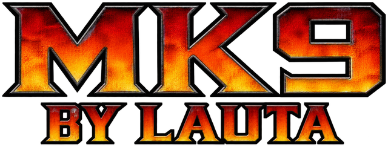
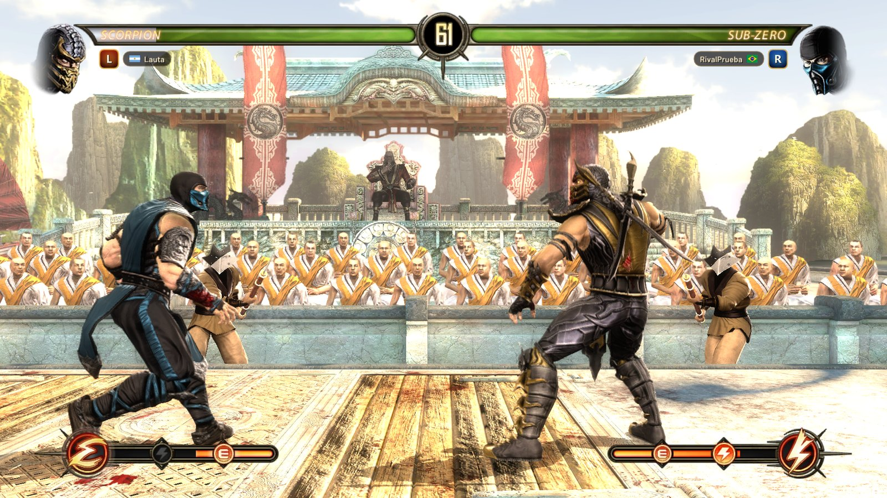

<h3>Mortal Kombat Komplete Edition, native on PC, with rollback netcode</h3>

Made by <b>Lauta</b> · Non-profit.

 

[Español](README.md) · **English**

 

## What is it?

**MK9 by Lauta** is the Xbox 360 release of Mortal Kombat Komplete Edition running natively on Windows. It is not an
emulator: the game's own code is recompiled for the PC, and on top of it comes what it needed to be played today:
online play with rollback, rooms to play with friends, graphics that adapt to your PC, and keyboard and controller
support ready for fighting.

> [!IMPORTANT]
> The game is not included. You need your own copy of **Mortal Kombat Komplete Edition for Xbox 360** as an `.iso`
> disc image (the European release: English, French, German, Spanish, Italian and Portuguese). The first time you open
> the program you pick your ISO, and that's it.

## Features

**Online with rollback.** Your moves come out at once and, when the connection hiccups, the game corrects itself
without stopping. Quick match, public rooms and private rooms with a code, chat, flags, a profile with your stats and
picture, and live spectating of other players' matches.

**The whole game.** Story mode, Ladder and Tag Ladder, two-player Versus on one PC, the Challenge Tower, Training, the
Krypt and every Komplete Edition fighter. Kratos, the PlayStation 3 release's guest fighter, downloads by himself the
first time you open the game.

**Runs on your PC.** Direct3D 12 or Vulkan, from 480p to 4K. The first start picks a quality preset from your graphics
card ("Muy baja" to "Ultra"), and dynamic resolution lowers it a little when needed to keep 60 FPS. Integrated graphics
work too.

**Keyboard and controllers.** The keyboard comes set up for fighting, and Xbox, PlayStation and Switch Pro controllers
work with vibration and their own button prompts. Everything can be remapped.

**Updates by itself.** When a new version is out, the game says so at start and updates without touching your saves
or settings.

## Installing

1. **Download** the `.zip` of the [latest release](https://github.com/machinebreak/mk9-lauta/releases/latest).
2. **Unpack it** anywhere with about 8 GB free (better not inside "Program Files").
3. **Open `mk9.exe`** and pick your game's `.iso` image, or the folder you already extracted it to. The installer checks
   the release and copies the files the game uses. This happens once; later starts go straight in.
4. **Play.** **F1** opens the online screens and **F2** the settings (with a controller: **BACK + Y** and
   **BACK + START**). The first start asks for your language: the game's six, with the online screens in English,
   Spanish or Portuguese.

> [!NOTE]
> The program has no digital signature, so Windows SmartScreen may say "Windows protected your PC": click **More info**
> and **Run anyway**. The first time you go online, Windows asks whether the game may use the network: **Allow** it.

## Requirements

| | What you need |
|---|---|
| **OS** | Windows 10 or 11, 64-bit |
| **Graphics** | Direct3D 12 or Vulkan capable (integrated graphics work) |
| **Memory** | 4 GB of RAM |
| **Disk** | About 8 GB free |
| **Game** | Your copy of Mortal Kombat Komplete Edition for Xbox 360, as an `.iso` (European release) |

## Playing online

1. Press **F1** and choose your name.
2. Use **Partida rápida** (quick match), create a room (public, or private with a code to share with a friend) or join
   one with its code.
3. When both players press **Estoy listo** (ready), the game restarts already connected. One player picks **VERSUS**
   (one vs one, two vs two or test your luck), the other joins with START, and each picks a fighter.

Both players need the same version; the game updates itself. The full players' guide (in Spanish) is in
[docs/online/guia-jugadores.md](docs/online/guia-jugadores.md) and in the zip's `LEEME.txt`.

## Community

Join the [Discord](https://discord.gg/7hbqkDmKHA) to find opponents, get the news first and get help. Bugs can also go
to the [issues](https://github.com/machinebreak/mk9-lauta/issues), with the latest `mk9_*.log` from the `logs` folder.

## Building from source

You need Visual Studio 2022 Build Tools, LLVM clang 20, Python 3, Git and about 30 GB free; see
[docs/building.md](docs/building.md). The build extracts your disc, translates the game's code from your `default.xex`
(into `app/generated`, which is not in this repository) and builds the program. `tools/release/make_release.ps1 -Zip`
packs a release (the program, the Visual C++ runtime, the guide and the licenses; no game data).

## Credits

**MK9 by Lauta** is a project by **Lauta** ([machinebreak](https://github.com/machinebreak) on GitHub), built on the
work of many people who share their code:

- [mk9-nx](https://github.com/Thorhax/mk9-nx), [Thorhax](https://github.com/Thorhax)'s static recompilation of MK9, and
  the projects it comes from.
- The [ReXGlue SDK](https://github.com/rexglue/rexglue-sdk) by Tom Clay, with parts of [Xenia](https://xenia.jp).
- [reNut](https://github.com/masterspike52/reNut) by masterspike52, the renderer, used with its author's permission.
- [plume](https://github.com/renderbag/plume), [XenosRecomp](https://github.com/hedge-dev/XenosRecomp),
  [libjuice](https://github.com/paullouisageneau/libjuice), [SDL](https://www.libsdl.org), [FFmpeg](https://ffmpeg.org)
  and [Dear ImGui](https://github.com/ocornut/imgui).
- [eLGatoRDV](https://github.com/eLGatoRDV/mk9-kratos-xbox360)'s Xbox 360 port of Kratos.

The full list, with every license, is in [THIRD_PARTY_NOTICES.md](THIRD_PARTY_NOTICES.md).

## License and legal

This project's code is free software under the [GPL-3.0](LICENSE); the SDK (`sdk/`) is under BSD-3-Clause
([sdk/LICENSE](sdk/LICENSE)) and the shader translator (`shaders/`) under MIT ([shaders/LICENSE.md](shaders/LICENSE.md)).
Whoever passes it on, changed or not, has to offer its source under the same license. The game's code, translated
from your disc when the program is built, is not ours: it belongs to the game's rights holders.

This is a free, non-profit fan project. It is not affiliated with or endorsed by Warner Bros. Games, NetherRealm
Studios, Microsoft or any other rights holder of the game. Mortal Kombat is a trademark of Warner Bros. Entertainment.
It includes no game files: you need your own legally obtained copy.

 

 
Made by Lauta, for the community.

