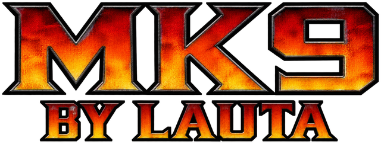
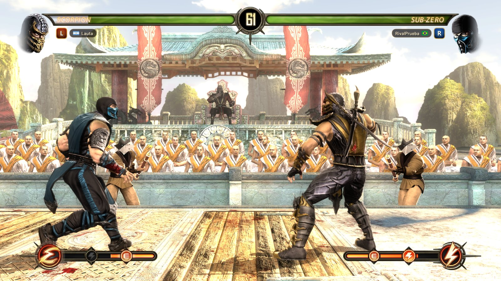
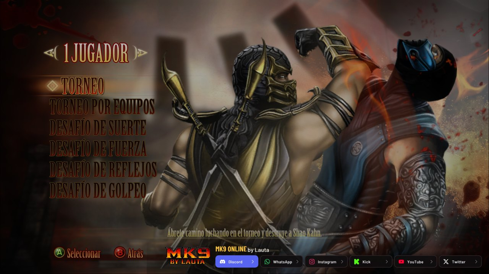
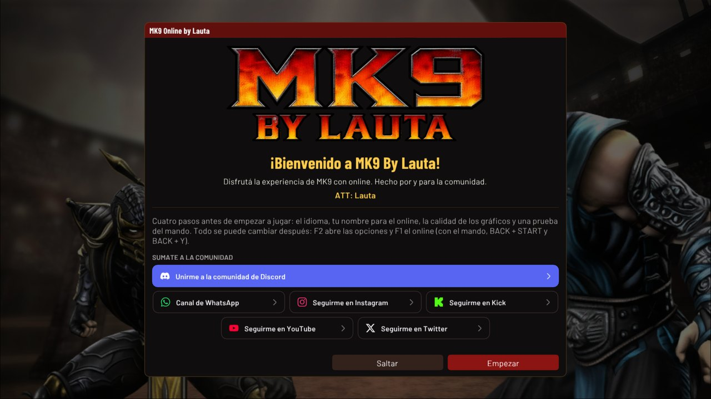

<h3>Mortal Kombat Komplete Edition, nativo en PC, con online y rollback</h3>

Hecho por <b>Lauta</b> · gratis, sin publicidad y sin cuentas

 

**Español** · [English](README.en.md)

 

## ¿Qué es?

**MK9 by Lauta** es el Mortal Kombat Komplete Edition de Xbox 360 funcionando de forma nativa en Windows. No es un
emulador: el código del juego está recompilado para PC, y encima tiene lo que le faltaba para jugarlo hoy: online con
rollback, salas para jugar con amigos, gráficos que se ajustan a tu PC y controles listos para teclado o mando.

> [!IMPORTANT]
> El juego no viene incluido. Necesitás tu copia de **Mortal Kombat Komplete Edition de Xbox 360** como imagen `.iso`
> del disco (la versión europea: inglés, francés, alemán, español, italiano y portugués). La primera vez que abrís el
> programa elegís tu ISO, y listo.

## Lo que tiene

**Online con rollback.** Tus golpes salen al instante y, si la conexión pega un salto, el juego se corrige solo sin
frenarse. Partida rápida, salas públicas o privadas con código, chat, banderas, un perfil con tus estadísticas y tu
foto, y la opción de mirar en vivo las partidas de los demás.

**El juego completo.** El modo Historia (doblado al español), Torneo y Torneo por equipos, Versus de a dos en la misma
PC, la Torre de desafíos, Práctica, la Kripta y todos los luchadores de la Komplete Edition. Kratos, el invitado de la
versión de PlayStation 3, se descarga solo la primera vez que abrís el juego.

**Anda en tu PC.** DirectX 12 o Vulkan, de 480p a 4K. La primera vez elige la calidad según tu placa de video (de "Muy
baja" a "Ultra"), y la resolución dinámica la baja un poco cuando hace falta para no perder los 60 FPS. También
funciona con gráficos integrados.

**Teclado y mandos.** Viene configurado para pelear con el teclado y reconoce mandos de Xbox, PlayStation y Switch Pro,
con vibración y sus propios botones en pantalla. Todo se puede reasignar.

**Se actualiza solo.** Cuando sale una versión nueva, el juego te avisa al abrirse y se actualiza sin tocar tus
partidas guardadas ni tus opciones.

  
  

## Cómo instalarlo

1. **Descargá** el `.zip` de la [última versión](https://github.com/machinebreak/mk9-lauta/releases/latest).
2. **Descomprimilo** donde quieras, en un disco con unos 8 GB libres (mejor no adentro de "Archivos de programa").
3. **Abrí `mk9.exe`** y elegí la imagen `.iso` de tu juego, o la carpeta donde ya lo tenés extraído. Se revisa que sea
   la versión correcta y se copian los archivos que usa el juego. Esto pasa una sola vez: después arranca directo.
4. **A jugar.** **F1** abre el online y **F2** las opciones (con mando: **BACK + Y** y **BACK + START**).

> [!NOTE]
> Como el programa no tiene firma digital, Windows puede mostrar "Windows protegió tu PC": tocá **Más información** y
> después **Ejecutar de todas formas**. La primera vez que entres al online, Windows pregunta si el juego puede usar la
> red: dale **Permitir**.

## Requisitos

| | Lo que necesitás |
|---|---|
| **Sistema** | Windows 10 u 11 de 64 bits |
| **Placa de video** | Compatible con DirectX 12 o Vulkan (sirven las integradas) |
| **Memoria** | 4 GB de RAM |
| **Espacio** | Unos 8 GB libres |
| **Juego** | Tu copia de Mortal Kombat Komplete Edition de Xbox 360, en `.iso` (versión europea) |

## Jugar online

1. Apretá **F1** y elegí tu nombre.
2. Entrá a **Partida rápida**, creá una sala (pública, o privada con un código para pasarle a un amigo) o unite a una
   con su código.
3. Cuando los dos tocan **Estoy listo**, el juego se reinicia ya conectado. Uno elige **VERSUS** (uno contra uno o dos
   contra dos), el otro se suma con START y cada uno elige su luchador.

Los dos tienen que tener la misma versión, y el juego se actualiza solo. La guía completa, con los controles y todas
las opciones, está en [docs/online/guia-jugadores.md](docs/online/guia-jugadores.md) y en el `LEEME.txt` del zip.

## Preguntas frecuentes

<b>¿Es un emulador?</b>

No. El código del juego de Xbox 360 está traducido a código de PC (recompilación estática), con un renderizador, sonido
y controles nuevos debajo. Por eso anda a 60 FPS en PCs modestas, donde un emulador no llega.

<b>¿Viene con el juego? ¿Qué versión necesito?</b>

No incluye ningún archivo del juego. Necesitás tu propia copia: la imagen `.iso` del disco de Mortal Kombat Komplete
Edition de Xbox 360, versión europea (la que trae inglés, francés, alemán, español, italiano y portugués). Las imágenes
comprimidas (CCI, GOD, ZAR) no se leen.

<b>No me conecta al online</b>

Abrí **F1**. Si dice "Sin conexión con el lobby", tocá **Copiar diagnóstico** y mandalo en el
[Discord](https://discord.gg/7hbqkDmKHA) junto con el último `mk9_*.log` de la carpeta `logs` (**F2 > Acerca de > Abrir
la carpeta de logs**). Revisá también que Windows le haya dado permiso de red al juego.

<b>¿Dónde está Kratos?</b>

La primera vez que abrís el juego se descarga solo (unos 95 MB, del port de la comunidad hecho por eLGatoRDV) y se
instala antes de empezar. En la selección de personajes está en la fila de extras, abajo a la izquierda.

<b>¿Anda en una PC de bajos recursos?</b>

Está pensado para eso. La primera vez elige la calidad según tu placa y tu memoria, y en **F2 > Gráficos** podés bajarla
a "Baja" o "Muy baja", usar la resolución dinámica o dibujar uno de cada dos cuadros (la pelea sigue a 60). Con 6 GB de
RAM o menos se activa solo el ahorro de memoria.

<b>¿Puedo jugar con alguien que tiene otra versión?</b>

No, los dos necesitan la misma. Cuando sale una nueva, el juego avisa al abrirse y se actualiza solo (también se puede
buscar a mano en **F2 > Acerca de**).

<b>¿Es seguro?</b>

Descargalo sólo de esta página. Es gratis y de código abierto: no pide cuentas, no tiene publicidad ni pagos, y cada
actualización viene firmada (el juego verifica la firma antes de instalarla). Si alguien te lo vende o te lo pasa por
otro lado, no es oficial.

<b>¿Hay versión para celular, Linux o Mac?</b>

Por ahora, sólo Windows. Las novedades se anuncian en el Discord y en las redes de Lauta.

## Comunidad

En el [Discord](https://discord.gg/7hbqkDmKHA) vas a encontrar rivales, las novedades antes que nadie y ayuda si algo
no anda. Si encontrás un error, también podés abrir un [issue](https://github.com/machinebreak/mk9-lauta/issues)
contando qué pasó y adjuntando el `mk9_*.log` de la carpeta `logs`.

## Para desarrolladores

Para compilarlo hacen falta Visual Studio 2022 Build Tools, LLVM clang 20, Python 3, Git y unos 30 GB libres; los pasos
están en [docs/building.md](docs/building.md). La compilación extrae tu disco, traduce el código del juego desde tu
`default.xex` (a `app/generated`, que no está en el repositorio) y arma el programa.
`tools/release/make_release.ps1 -Zip` empaqueta una versión (el programa, el runtime de Visual C++, la guía y las
licencias; ningún archivo del juego).

Cómo está organizado el código

| Carpeta | Qué hay |
|---|---|
| `app/src/` | Lo propio de PC: opciones y controles, instalador, detección del hardware, textos, ritmo de cuadros |
| `app/src/online/` | El online: lobby, salas, ICE (libjuice), sesiones, el netcode (lockstep y rollback), la línea de tiempo de la memoria, el sonido sincronizado |
| `app/src/renut_engine/` | El renderizador Renut, adaptado al Direct3D de MK9 (Direct3D 12 y Vulkan a través de plume) |
| `app/thirdparty/` | libjuice, plume, Dear ImGui, el traductor de shaders y sus herramientas |
| `sdk/` | El SDK ReXGlue: generador de código, kernel y runtime de Xbox 360, audio, entrada y archivos |
| `shaders/` | XenosRecomp, el traductor de shaders de Xbox 360 |
| `tools/` | Scripts de compilación, pruebas (`tools/online`) y versiones (`tools/release`) |
| `docs/` | Notas del juego y del port; en `docs/online/`, el diseño del netcode y la guía para jugadores |

## Créditos

**MK9 by Lauta** es un proyecto de **Lauta** ([machinebreak](https://github.com/machinebreak) en GitHub), y se apoya
en el trabajo de mucha gente que comparte su código:

- La recompilación estática de MK9 de [Thorhax](https://github.com/Thorhax) y los proyectos de los que viene.
- El [ReXGlue SDK](https://github.com/rexglue/rexglue-sdk) de Tom Clay, con partes de [Xenia](https://xenia.jp).
- [reNut](https://github.com/masterspike52/reNut) de masterspike52, el renderizador, usado con permiso de su autor.
- [plume](https://github.com/renderbag/plume), [XenosRecomp](https://github.com/hedge-dev/XenosRecomp),
  [libjuice](https://github.com/paullouisageneau/libjuice), [SDL](https://www.libsdl.org), [FFmpeg](https://ffmpeg.org)
  y [Dear ImGui](https://github.com/ocornut/imgui).
- El port de Kratos a Xbox 360 de [eLGatoRDV](https://github.com/eLGatoRDV/mk9-kratos-xbox360).

La lista completa, con la licencia de cada uno, está en [THIRD_PARTY_NOTICES.md](THIRD_PARTY_NOTICES.md). Desarrollado
con ayuda de herramientas de IA.

## Licencia y aviso legal

El código de este proyecto es software libre bajo la [GPL-3.0](LICENSE); el SDK (`sdk/`) está bajo BSD-3-Clause
([sdk/LICENSE](sdk/LICENSE)) y el traductor de shaders (`shaders/`) bajo MIT ([shaders/LICENSE.md](shaders/LICENSE.md)).
Quien lo vuelva a distribuir, con cambios o sin ellos, tiene que ofrecer su código fuente bajo la misma licencia. El
código del juego, que se traduce desde tu disco al compilar, no es nuestro: pertenece a los dueños del juego.

Es un proyecto de fans, gratuito y sin fines de lucro. No está afiliado ni respaldado por Warner Bros. Games,
NetherRealm Studios, Microsoft ni ningún otro dueño de los derechos del juego. Mortal Kombat es una marca de Warner
Bros. Entertainment. No incluye archivos del juego: necesitás tu propia copia legal.

 

 
Hecho por Lauta, para la comunidad.

